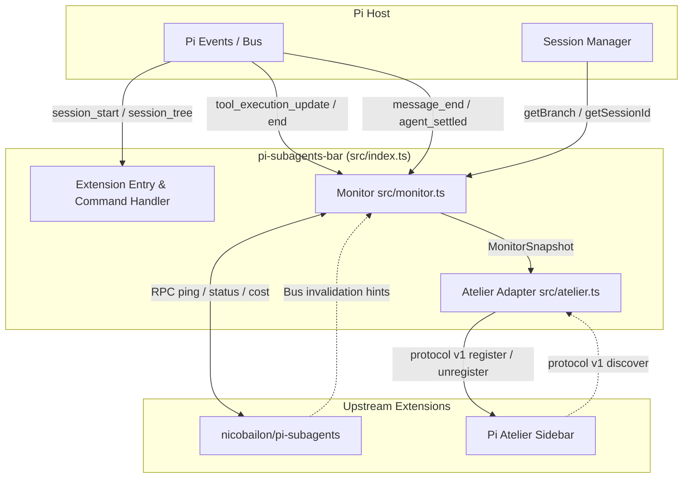

# Architecture

`pi-subagents-bar` is a minimal, read-only Pi Atelier sidebar extension that observes foreground and background executions from `nicobailon/pi-subagents`. It contributes a single sidebar panel to Pi Atelier using public protocols, operating without private configuration access, process spawning, prompt modifications, or status polling.

## Component overview

The codebase is structured into three primary modules and a shared type contract:

- `src/index.ts`: Pi extension coordinator.
  - Registers the extension entry point with Pi's extension loader.
  - Subscribes to Pi lifecycle events: `session_start`, `session_tree`, `tool_execution_update`, `tool_execution_end`, `message_end`, `agent_settled`, and `session_shutdown`.
  - Registers the slash command `/subagents-bar` (`show`, `hide`, `toggle`) for user toggling between expanded rows and summary-only display.
  - Maintains the in-memory display mode preference (`expanded`) within the extension factory closure (persisting across session transitions within the same loaded instance; reset on extension reload).
  - Owns session generation boundaries, ensuring complete disposal of old monitors, timers, and listeners on session restart or switch.

- `src/monitor.ts`: Observer, RPC client, and state normalizer.
  - Negotiates public RPC capabilities with `nicobailon/pi-subagents` (`ping`, `status`, optional `cost`) over the public event transport.
  - Listens for advertised bus event invalidation hints (`ready`, `jobsChanged`, `asyncStarted`, `childStatus`, `asyncComplete`, `processTerminal`).
  - Coalesces rapid event bursts with a 250 ms debounced window, maintaining a single in-flight status request and a dirty bit for pending updates.
  - Reconstructs current-branch history from session messages (`toolResult` for foreground subagents, `custom_message` with `subagent-notify` for completion notices) via `ctx.sessionManager.getBranch()`.
  - Normalizes heterogenous representations into structured display records:
    - Foreground executions tracked via `(Details.runId, index)` tuples, promoted from provisional `("tool", toolCallId, index)`.
    - Async executions tracked via root IDs and node ancestor tuples.
    - Structured notices update child or parent records without fabricating duplicate child rows.
    - Opaque fleet keys are separated into aggregate diagnostic counts (`Provider: N active; M outside fleet window`) rather than uncorrelatable execution rows.
  - Orders display categories as active (`queued`, `running`) → failed (`failed`, `rejected`) → neutral (`paused`, `stopped`, `interrupted`, `cancelled`, `partial`, `detached`, `unknown`) → success (`completed`). This is display priority, not a lifecycle transition sequence; terminal records never regress to running.
  - Refreshes elapsed execution time locally via a 1-second display timer running only while observed running records exist; freezes elapsed time if an active record vanishes from the provider projection.
  - Enriches terminal usage via optional public `cost` RPC at lifecycle boundaries (`agent_settled`, completion), matching unique exact child run IDs only.
  - Enforces memory bounds: retains at most 100 non-active display records (reporting eviction as `history limited`), while retaining all known active records.

- `src/atelier.ts`: Presentation adapter.
  - Implements the Pi Atelier sidebar panels protocol v1 over channel `pi-atelier:sidebar-panels`.
  - Publishes panel registration under ID `subagents-bar:subagents`, title `Subagents`, source `subagents-bar`.
  - Allocates monotonic positive safe-integer revisions per source across publisher instances using a bus-keyed `WeakMap`.
  - Handles protocol discovery (`discover`), echoing requests with the latest panel contribution.
  - Sanitizes plain-text output: strips ANSI/OSC escapes, control characters, and line breaks; caps line lengths to 160 Unicode code points (title to 48).
  - Enforces a 24-row maximum budget: summary row → diagnostic row → execution rows (collapsing 2 rows to 1 row per execution if needed to preserve active visibility) → compact overflow indicator row.
  - Maps execution states to Atelier semantic roles (`working`, `error`, `caution`, `success`, `primary`, `muted`).

- `src/types.ts`: Shared type definitions.
  - Defines the boundary contract between monitor and renderer: `EventTransport`, `SnapshotRecord`, `MonitorSnapshot`, `RecordCategory`, and `PENDING_SNAPSHOT`.

## Runtime data flow

## Architectural boundaries and invariants

1. **Read-only observation**: The extension does not initiate, control, pause, or cancel subagent runs. It registers no LLM tools, modifies no prompt contexts, and injects no instructions.
2. **Public protocol integration**: All interactions with `nicobailon/pi-subagents` and `pi-atelier` occur exclusively through public event bus channels and RPC methods. No private files, settings, or internal extension modules are accessed.
3. **Session isolation**: State is ephemeral and scoped to the active session generation. Branch switches (`session_tree`) clear branch-derived state and invalidate old RPC replies before rebuilding from the current branch leaf. Attribution of previously unseen, untagged same-session tool events has the limitation below.
4. **Honest degradation & partial coverage**:
   - Provider fleet metrics with opaque keys are presented as aggregate counts, not merged into execution rows.
   - Vanished active records without explicit terminal evidence remain in their last known state marked stale.
   - Foreground completion notices lacking child indices for multi-child runs leave detached runs in neutral status rather than assuming success.
   - Late events for previously unseen tool calls may still be observed after branch navigation. The public event has no branch tag, so exact attribution is not guaranteed; known prior calls and old RPC replies are ignored.
5. **In-memory state**: No disk configuration is read or written. The display mode preference (`expanded`) is held in closure state and resets on extension reload.
